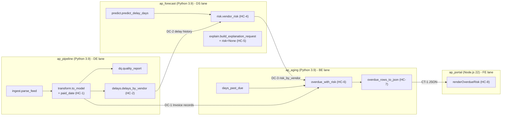
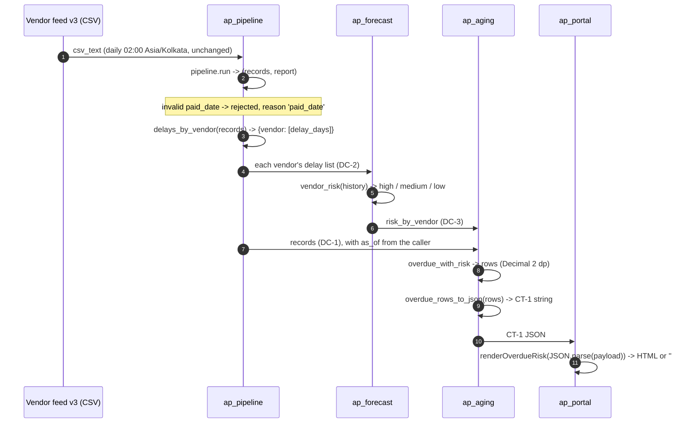

<!-- input feat.design for FE-03: from hobasa-design-agent/outputs/FEAT-ZD-48600/feat.design.md at commit 722a98f, produced by DES-02 -->
# feat.design: FEAT-ZD-48600

Architecture design document (HLD and LLD) for FEAT-ZD-48600 (ZD-48600, "Show which overdue invoices belong to vendors that usually pay late"). This is a draft for the DES-02 gate (Architect, UX lead).

This document turns the approved TRD (feat.trd) into a build design for the four coding lanes. It adds no scope beyond feat.prd S-1 to S-7. Every design decision cites the architecture (org.architecture), a contract (feat.trd IF-1 to IF-8, CT-1), the data model (org.data_model), the design library (org.design_library) or a requirement (feat.prd AC / NFR). Statements marked **design decision (agent judgement)** are this agent's proposal for the Architect to accept or change; no input states them as fact. No new technology is introduced: everything uses the Python 3.9 standard library (`datetime`, `decimal`, `json`, `typing`) and Node.js 22 CommonJS, which org.architecture already names.

| Field | Value | Source |
|---|---|---|
| Trace ID | FEAT-ZD-48600 | record:brief; feat.trd |
| Step | DES-02 Design Document (attempt 1) | record:brief |
| Trigger | TRD Completion | record:brief |
| Owner / gate | Architect / Architect, UX lead | record:brief |
| Inputs | feat.prd, feat.prototype, feat.trd, org.architecture, org.data_model, org.design_library | record:brief |
| Background read | feat.stories (approved, REQ-08); DES-01 check record (no platform change) | journey:feat.stories; file:hobasa-design-agent/outputs/FEAT-ZD-48600/checks/DES-01_feat.platform_update.md |
| Code read | The four repositories' source and tests, as given in the step's tool view | tool:repo |
| Companion output | feat.screens (final screen specification for SC-1) | record:brief |
| Risk tier (advisory) | T2. "The risk label is advisory only." | feat.trd (header, S-1); feat.prd (header, NFR-6, NFR-7) |
| Architecture rule | "Keep every existing signature; add new functions." | org.architecture |

---

# Part A. High-Level Design (HLD)

## A1. Context

AP managers need the unpaid invoices that are more than 30 days past due, each marked with its vendor's payment-risk level, so they can choose which to chase first (feat.prd US-1, B-A1). The feature adds one step to each of the four repositories that org.architecture already chains together, and an end-to-end proof across them (feat.prd S-1 to S-7).

| Boundary | In this design | Out of this design | Source |
|---|---|---|---|
| Repositories | ap_pipeline, ap_forecast, ap_aging, ap_portal (unchanged topology) | New repository, service or runtime | org.architecture; DES-01 check record (K-1, K-2) |
| Data | One new record key `paid_date`; one new reject reason `'paid_date'`; in-memory delay history, risk map, overdue rows; CT-1 JSON | Storage, database, schema migration | org.data_model; feat.trd (section 3, data rules) |
| UI | One table component SC-1 (`renderOverdueRisk`) | Host page, navigation, filters, row actions | feat.prototype (section 2, PQ-P2, PQ-P7) |
| Security | Output encoding in ap_portal; advisory-only risk label | Finance posting, authentication, tenancy, payment execution | feat.trd (S-1 to S-6); feat.prd (NFR-6, NFR-7) |
| LLM | Optional risk label appended to the existing explanation prompt | Provider or model change; LLM in the risk rule | feat.trd (IF-3.2, IF-4.4); feat.prd (section 1 "Not in this change") |

DES-01 ran in check mode and found no platform-level change: all six platform elements (topology, runtimes, repository roles, JSON contract rule, compatibility rule, security boundary) are kept (file:hobasa-design-agent/outputs/FEAT-ZD-48600/checks/DES-01_feat.platform_update.md). This design keeps that position; section A8 lists what would reopen it.

## A2. Components

| ID | Repository / lane | Component | Kind | Change | TRD / PRD trace |
|---|---|---|---|---|---|
| HC-1 | ap_pipeline / DE | `transform.to_model` (`src/ap_pipeline/transform.py`) | Changed, additive | Reads optional `paid_date`; adds `paid_date` key; rejects invalid with reason `'paid_date'` | C-1; IF-1; AC-1 to AC-3 |
| HC-2 | ap_pipeline / DE | `delays.delays_by_vendor` (new module `src/ap_pipeline/delays.py`) | New | `{vendor: [delay_days, ...]}` | C-2; IF-2; AC-4 to AC-6 |
| HC-3 | ap_pipeline | `ingest.parse_feed`, `dq.quality_report`, `pipeline.run` | Unchanged | `'paid_date'` flows into `reject_reasons` by itself | C-3; F-4, F-5 |
| HC-4 | ap_forecast / DS | `risk.vendor_risk` (new module `src/ap_forecast/risk.py`), exported | New | Rule on `predict_delay_days`; no LLM | C-4; IF-3; AC-7 to AC-10 |
| HC-5 | ap_forecast / DS | `explain.build_explanation_request` | Changed, additive | New last parameter `risk=None` | C-5; IF-4; AC-11, AC-12 |
| HC-6 | ap_aging / BE | `aging.overdue_with_risk`, exported | New | Overdue list with risk | C-6; IF-5; AC-13 to AC-18 |
| HC-7 | ap_aging / BE | `aging.overdue_rows_to_json`, exported | New | Serialises rows to CT-1 | C-7; IF-6; AC-18 |
| HC-8 | ap_portal / FE | `renderOverdueRisk` in `src/ap_portal/index.js`, exported | New | Renders SC-1 | C-8; IF-7; AC-19 to AC-21 |
| HC-9 | ap_portal | `formatAmount`, `renderAgingSummary` | Unchanged | Not reused by HC-8 | C-9; F-12, F-13 |
| HC-10 | Cross-repo / Testing Agent | End-to-end harness | New test asset (not deployed) | IF-8 wiring, Python stages then Node.js render | C-10; IF-8; AC-22, AC-23 |

Sources: feat.trd (section 1, IF-1 to IF-8, T-A4); feat.prd (sections 3.1 to 3.6); tool:repo.



## A3. Interfaces and data contracts between repositories

Each lane builds against these contracts, not against another lane's code. This is why the lanes can run in parallel (section C).

| ID | From → To | Contract | Shape | Rules | Source |
|---|---|---|---|---|---|
| DC-1 | ap_pipeline → ap_aging | Invoice record (one per accepted feed row) | Python `dict`: `id` str, `vendor` str, `due_date` `date`, `amount` `Decimal`, `paid` bool, `paid_date` `date` or `None` | Plain dict, not a class. All existing keys unchanged; `paid_date` added. `overdue_with_risk` reads `id`, `vendor`, `due_date`, `amount`, `paid` | org.data_model; feat.trd (F-2, IF-1.6, D-2, IF-8); tool:repo (`transform.py`) |
| DC-2 | ap_pipeline → ap_forecast | Delay history | `Dict[str, List[int]]`; one vendor's list is `vendor_risk`'s `history` | Paid records with a `paid_date` only; feed order; negative values kept | feat.trd (IF-2, D-4); feat.prd (AC-4 to AC-6, AC-23, B-A3) |
| DC-3 | ap_forecast → ap_aging | Risk map `risk_by_vendor` | `Dict[str, str]`, values `'high'`, `'medium'`, `'low'` | Built by the caller as `{v: vendor_risk(h) for v, h in delays.items()}`; a vendor absent from the map gets `'unknown'` in ap_aging | feat.trd (IF-8, D-5); feat.prd (AC-17, AC-23, B-A3) |
| CT-1 | ap_aging → ap_portal | Overdue list JSON | JSON array of objects `{id: string, vendor: string, days: integer, amount: string, risk: string}`; `[]` when empty | `amount` is a two-decimal string with no exponent or thousands separator; `risk` is one of `high`, `medium`, `low`, `unknown`; rows in IF-5.6 order; no date field (any later date must be an ISO string) | feat.trd (IF-6, T-A1, D-7); feat.prd (AC-18, NFR-2); org.architecture |
| DC-4 | ap_forecast caller → LLM provider | Explanation request | `dict` `provider`, `model`, `max_tokens`, `messages` | Unchanged except the prompt may end with `' Risk level: <risk>.'` | feat.trd (IF-4, D-8); tool:repo (`explain.py`, `models.json`) |

**CT-1 example** (synthetic, from feat.prototype section 6): `[{"id": "SYN-INV-004", "vendor": "Synthetic Vendor A", "days": 75, "amount": "1250.00", "risk": "high"}]` (feat.trd IF-6).

**Transport for CT-1.** The code read shows no service or transport layer between ap_aging and ap_portal: `aging_buckets` returns Python values and `renderAgingSummary` takes a plain object (tool:repo; feat.trd IF-6, R-7). Design decision (agent judgement), DD-3 below: in this feature CT-1 is a serialised string produced by ap_aging and parsed by the consumer before `renderOverdueRisk(rows)` is called; this design adds no transport. A new transport would be a platform change and re-trigger DES-01 (trigger T-1 in the DES-01 check record).

## A4. Data flow



Sources: feat.trd (IF-8, D-1); feat.prd (section 1 "Flow", AC-22, AC-23, NFR-9); feat.prototype (section 4.1). Who calls the stages in production (the host that wires them) is not given in any input; in this feature the only wiring is the end-to-end harness (HC-10). This is open question DQ-1.

## A5. Non-functional needs

| ID | Need | Design response | Source |
|---|---|---|---|
| NF-1 | Money is `Decimal`, never `float` | Python keeps `Decimal` end to end (`Decimal(...)` conversion, `quantize(Decimal("0.01"))`); JSON carries a string; ap_portal treats the amount as a string and never calls `Number()`, `parseFloat` or `formatAmount` | feat.prd (NFR-1 to NFR-3); record:memory (D-2026-044, L-011); feat.trd (IF-5.5, IF-6, IF-7.5) |
| NF-2 | Calendar days after the due date | Reuse `days_past_due`; `delay_days` is `(paid_date - due_date).days` | record:memory (D-2026-031); feat.trd (IF-2.3, IF-5.2) |
| NF-3 | Paid invoices excluded | Same truthiness test as `aging_buckets` (`inv.get("paid")`) | record:memory (D-2026-050); feat.trd (IF-5.1); tool:repo (`aging.py`) |
| NF-4 | Backward compatibility | No existing signature or return shape changes; `risk` is the last parameter with default `None`; feed v2 (no `paid_date` column) still loads | org.architecture; feat.prd (NFR-4); feat.trd (IF-1.1, IF-4.1) |
| NF-5 | Auditability | `vendor_risk` is a fixed rule with no LLM; rejected rows name the reason `'paid_date'` | feat.prd (NFR-5, AC-10); feat.trd (S-3) |
| NF-6 | Advisory only | No code path acts on a risk value; SC-1 has no row actions | feat.prd (NFR-6); feat.trd (S-2); feat.prototype (PQ-P7) |
| NF-7 | Output encoding | `renderOverdueRisk` HTML-escapes `id` and `vendor` and allow-lists the row class | feat.trd (IF-7.4, IF-7.7, S-4); feat.prd (NFR-7, OQ-B8) |
| NF-8 | Boundary tests | Exactly 30 days past due (not listed); predicted delay exactly 30 (`'medium'`) and exactly 10 (`'low'`) | feat.prd (NFR-8); record:memory (L-007); feat.trd (T-6, T-8) |
| NF-8a | Design-library rules DL-1 to DL-4 (numbering from feat.prototype) | Applied by `renderOverdueRisk`; see feat.screens | org.design_library; feat.prototype (section 1) |
| NF-9 | CI quality bar | Every lane keeps compile, unit tests, coverage of at least 90% and static checks green; Python 3.9 syntax only (no `match`, no `X \| Y` unions); no `print`, `eval`, `exec`, bare `except`, `console.log`; lines at most 140 characters | feat.trd (F-14, F-15) |
| NF-10 | Purity | Every new function is pure and in-memory: no I/O, no network, no mutation of inputs | feat.trd (IF-2.6, IF-5.8, section 3 data rules) |
| NF-11 | Performance, volume, availability | Not given in any input; no target is invented. Agent judgement: every new Python function is a single pass over its input, plus one sort in `overdue_with_risk` | feat.prd (NFR-11, PQ-4); feat.trd (R-10) |
| NF-12 | Terminology | Only "overdue" / "Days overdue"; never the regulatory "Late" | feat.prd (NFR-10); feat.prototype (section 7) |

## A6. Security and tenancy

| ID | Item | Design | Source |
|---|---|---|---|
| SE-1 | Tenancy, authentication, finance posting, payment execution | Not touched; tier T2 | feat.trd (S-1); org.architecture |
| SE-2 | Injection into the portal page | Escape `&`, `<`, `>`, `"`, `'` in `id` and `vendor`; class restricted to the four `risk-*` values. Agent judgement: `days` and `amount` are also validated before output (DD-8, B4.4) | feat.trd (IF-7.4, IF-7.7, R-8) |
| SE-3 | External data flow | With `risk`, the explanation prompt also carries the vendor's risk label to the configured provider (`acme-llm`). Provider and model unchanged. Architect to confirm (TQ-8) | feat.trd (S-5, TQ-8); tool:repo (`models.json`) |
| SE-4 | Secrets and personal data | None added; tests and examples use synthetic data (`SYN-INV-*`, "Synthetic Vendor <letter>") | feat.trd (S-6); feat.prototype (SD-1) |

Tenancy and security impact is clear for this change (no tenancy surface), so no stop-and-ask applies.

## A7. Design decisions

Each decision cites what it rests on. Decisions marked "agent judgement" are proposals for the gate.

| ID | Decision | Rests on | Status |
|---|---|---|---|
| DD-1 | No new repository, service, runtime, library or storage. Only the Python 3.9 standard library and Node.js 22 CommonJS are used | org.architecture; feat.trd (F-15, section 3); DES-01 check record (K-1, K-2, K-6) | From inputs |
| DD-2 | Module placement as TRD T-A4: `src/ap_pipeline/delays.py`, `src/ap_forecast/risk.py`, `overdue_with_risk` and `overdue_rows_to_json` in `src/ap_aging/aging.py`, `renderOverdueRisk` in `src/ap_portal/index.js` | feat.trd (T-A4, C-2, C-4, C-6, C-7, C-8) | From approved TRD |
| DD-3 | CT-1 is adopted as the ap_aging → ap_portal contract exactly as in IF-6. ap_aging owns serialisation (`overdue_rows_to_json`); the consumer parses the string and passes the array to `renderOverdueRisk`. No transport layer is added in this feature | feat.trd (IF-6, C-7, T-A1, R-7); feat.prd (AC-18, NFR-2, PQ-3); org.architecture | Agent judgement; TQ-3 still to be confirmed |
| DD-4 | `overdue_with_risk` never calls `bucket_for`; it applies `days > 30` itself through a module constant | feat.trd (F-10, IF-5.3, R-1); feat.prd (AC-14) | From TRD; the constant name is agent judgement |
| DD-5 | `renderOverdueRisk` never uses `formatAmount`; amounts go through a string-only helper that pads to two decimals and rejects non-decimal input | feat.trd (F-12, IF-7.5, R-2); feat.prd (NFR-3) | From TRD; padding pending TQ-11 |
| DD-6 | `paid_date` is validated only after the existing field checks pass (existing reject reasons win) | feat.trd (IF-1.5, T-A3) | From TRD; pending TQ-10 |
| DD-7 | An unpaid row with a valid `paid_date` is accepted and keeps the date; `delays_by_vendor` ignores it | feat.trd (IF-1.7, IF-2.2) | Interim; pending OQ-B6 |
| DD-8 | Contract violations raise, they are not hidden: ap_aging raises `KeyError` for a missing `vendor` (TQ-9); ap_portal raises `TypeError` for an amount that is not a decimal string or a non-integer `days` | feat.trd (IF-5.7, IF-7.5) | Agent judgement for the ap_portal `TypeError` (DQ-3) |
| DD-9 | `vendor_risk` thresholds are named module constants (`HIGH_ABOVE_DAYS = 30`, `MEDIUM_ABOVE_DAYS = 10`), compared with strict `>` on the rounded prediction | feat.trd (IF-3.1, IF-3.4); feat.prd (AC-7 to AC-9) | Agent judgement on naming |
| DD-10 | The overdue `amount` is quantised to two decimals with the default `decimal` context (round-half-even). Feed amounts already have two decimals by the data model, so this only matters for malformed feeds | feat.trd (IF-5.5); org.data_model ("amount (Decimal, 2 dp)") | Agent judgement on rounding mode (DQ-2) |
| DD-11 | Each changed package takes a minor version step, for the lane to confirm | feat.trd (T-A6) | From TRD |

## A8. What would reopen the platform architecture (DES-01)

Carried from the DES-01 check record: a transport or service between ap_aging and ap_portal (TQ-3), a platform-wide rule from TQ-1 / TQ-2, any storage or network call from the libraries, a provider or model change (PQ-5, TQ-8), or the end-to-end harness becoming a deployed component (file:hobasa-design-agent/outputs/FEAT-ZD-48600/checks/DES-01_feat.platform_update.md, triggers T-1 to T-6). This design triggers none of them.

---

# Part B. Low-Level Design (LLD) per repository

Conventions for all Python lanes: Python 3.9 typing (`typing.Dict`, `List`, `Iterable`, `Optional`), no syntax newer than 3.9, no `print` / `eval` / `exec` / bare `except`, lines at most 140 characters (feat.trd F-14, F-15).

## B1. ap_pipeline (DE lane): Python 3.9, package version `0.4.0` today

### B1.1 Modules

| Module | Change | Source |
|---|---|---|
| `src/ap_pipeline/transform.py` | Extend `to_model`; add private helper `_parse_paid_date` | feat.trd (C-1, IF-1); tool:repo |
| `src/ap_pipeline/delays.py` | New module with `delays_by_vendor` | feat.trd (C-2, T-A4) |
| `src/ap_pipeline/ingest.py`, `dq.py`, `pipeline.py` | No change | feat.trd (C-3) |
| `src/ap_pipeline/schedule.json` | No change (daily, 02:00, Asia/Kolkata) | tool:repo; feat.prd (NFR-9) |
| `src/ap_pipeline/__init__.py` | Version step only (DD-11) | feat.trd (T-A6) |

### B1.2 Functions

```python
# transform.py
PAID_DATE_REASON = "paid_date"

def _parse_paid_date(raw: Optional[str]) -> Optional[date]:
    """None when the value is missing, None or blank; else date.fromisoformat(value.strip()).
    Raises ValueError when the non-blank value is not an ISO date."""

def to_model(rows: List[Dict[str, str]]) -> Tuple[List[Dict], List[Dict]]:   # signature unchanged
    ...
```

`to_model` algorithm per row `r` (feat.trd IF-1.1 to IF-1.7):

1. Build the existing record exactly as today inside the existing `try`; on `(KeyError, ValueError, InvalidOperation, AttributeError)` append `{"row": r, "reason": type(e).__name__}` and continue (unchanged behaviour; tool:repo `transform.py`).
2. Only for a row that passed step 1: `paid_date = _parse_paid_date(r.get("paid_date"))`. On `ValueError` append `{"row": r, "reason": PAID_DATE_REASON}` and continue, adding no record (IF-1.4, DD-6).
3. Set `record["paid_date"] = paid_date` and append the record (IF-1.6). A row that is unpaid but has a valid `paid_date` keeps the date (DD-7).

```python
# delays.py
from typing import Dict, Iterable, List

def delays_by_vendor(records: Iterable[Dict]) -> Dict[str, List[int]]:
    """{vendor: [delay_days, ...]} for paid records with a paid_date; delay_days = (paid_date - due_date).days;
    values in feed order, vendors in first-seen order; negative delays kept; records not modified."""
```

Algorithm: for each record, skip unless `record.get("paid")` is truthy and `record.get("paid_date") is not None`; then `result.setdefault(record["vendor"], []).append((record["paid_date"] - record["due_date"]).days)` (feat.trd IF-2.2 to IF-2.5). The TRD signature types the input as `List[Dict]`; `Iterable[Dict]` accepts the same lists and is the only difference (agent judgement; a list argument behaves identically).

### B1.3 Data structures

| Structure | Shape | Source |
|---|---|---|
| Feed row (input) | `dict` of `str` from `csv.DictReader`; `paid_date` key may be missing (feed v2) or `None` (short row) | feat.trd (F-1, D-1) |
| Invoice record (DC-1) | `{"id", "vendor", "due_date": date, "amount": Decimal, "paid": bool, "paid_date": date or None}` | org.data_model; feat.trd (D-2) |
| Rejected row | `{"row": dict, "reason": str}`; new reason value `"paid_date"` | feat.trd (D-3) |
| Delay history (DC-2) | `Dict[str, List[int]]` | feat.trd (D-4) |

### B1.4 Error handling

| Case | Behaviour | Source |
|---|---|---|
| Missing column, `None` or blank `paid_date` | `paid_date = None`, row accepted | feat.trd (IF-1.1, IF-1.2) |
| Non-blank invalid `paid_date` (for example `"2026-13-01"`, `"not-a-date"`) on an otherwise valid row | Rejected with reason `'paid_date'` | feat.trd (IF-1.4, T-2) |
| Invalid existing field and invalid `paid_date` | Today's reason (exception type name) | feat.trd (IF-1.5, TQ-10) |
| Paid record without `paid_date` | Kept as a record; left out of the delay history; not rejected | feat.prd (AC-5); feat.trd (IF-2.2) |
| Record without `vendor` / `due_date` in `delays_by_vendor` | Not possible for `to_model` output; a hand-built record raises `KeyError` (no silent default) | feat.trd (F-2); agent judgement |

### B1.5 Tests to add (`tests/test_pipeline.py`, or a new `tests/test_delays.py`)

| Test | Asserts | TRD / story |
|---|---|---|
| `test_paid_date_empty_is_none` | Empty `paid_date` → record `paid_date is None` | T-1; AC-01.1 |
| `test_feed_v2_without_paid_date_column` | Feed with today's header loads; every record has `paid_date is None` | T-1; AC-01.2 |
| `test_paid_date_parsed_for_paid_row` | Valid ISO date on a paid row → `date` value | T-1; AC-01.3 |
| `test_invalid_paid_date_rejected` | `"2026-13-01"` and `"not-a-date"` → reason `'paid_date'`; `quality_report` lists it in `reject_reasons` | T-2; AC-01.4, AC-01.5 |
| `test_existing_reason_wins` | Bad `due_date` plus bad `paid_date` → `ValueError` reason | T-3; AC-01.6 |
| `test_unpaid_row_keeps_paid_date` | Unpaid row with valid `paid_date` accepted with the date | AC-01.7 |
| `test_delays_by_vendor_*` | Paid-with-date only; feed order; negative kept; paid-without-date excluded; unpaid-with-date excluded; vendor with no qualifying record has no key; input list unchanged | T-4; AC-02.1 to AC-02.8 |
| Existing tests | `test_run_maps_and_rejects`, `test_paid_flag`, `test_missing_column_rejected` pass unchanged | T-3; tool:repo |

## B2. ap_forecast (DS lane): Python 3.9, package version `0.9.0` today

### B2.1 Modules

| Module | Change | Source |
|---|---|---|
| `src/ap_forecast/risk.py` | New module with `vendor_risk` and two threshold constants | feat.trd (C-4, T-A4); DD-9 |
| `src/ap_forecast/explain.py` | `build_explanation_request` gains `risk=None` as the last parameter | feat.trd (C-5, IF-4) |
| `src/ap_forecast/__init__.py` | Import `vendor_risk`; add it to `__all__`; version step (DD-11) | feat.trd (F-8, T-A6) |
| `src/ap_forecast/predict.py`, `models.json` | No change | feat.trd (IF-3.2, IF-4.4) |

### B2.2 Functions

```python
# risk.py
from typing import Iterable
from .predict import predict_delay_days

HIGH_ABOVE_DAYS = 30
MEDIUM_ABOVE_DAYS = 10

def vendor_risk(history: Iterable[int]) -> str:
    """'high' if predict_delay_days(history) > 30, 'medium' if > 10, else 'low'. Rule only: no LLM, no config read."""
```

```python
# explain.py (existing function, additive)
def build_explanation_request(vendor: str, predicted_days: int, config=None, risk=None) -> dict:
    """Unchanged when risk is None. Otherwise the prompt is today's prompt + f" Risk level: {risk}."."""
```

Rules: `risk` is "given" when it is not `None` (IF-4.5, TQ-4). Provider, model and `max_tokens` still come from `config or load_config()` (IF-4.4). `vendor_risk` must not call `load_config` or read `models.json` (IF-3.2, AC-10); design choice (agent judgement): `risk.py` also does not import `explain`, so the rule cannot reach the LLM path.

### B2.3 Data structures

| Structure | Shape | Source |
|---|---|---|
| `history` | Iterable of `int` delay days for one vendor (DC-2 value) | feat.trd (IF-3, D-4) |
| Risk level | `str` in `{'high', 'medium', 'low'}` | feat.trd (IF-3.3, D-5) |
| Explanation request (DC-4) | `{"provider", "model", "max_tokens", "messages": [{"role": "user", "content": prompt}]}` | tool:repo (`explain.py`); feat.trd (D-8) |

### B2.4 Error handling

| Case | Behaviour | Source |
|---|---|---|
| Empty history | `predict_delay_days([])` is 0, so `'low'` | feat.trd (IF-3.3, F-6); PQ-1 |
| Early payments only | Negative delays count as 0 in the prediction, so `'low'` | feat.trd (F-6, R-5, TQ-5) |
| Non-integer values in history | `predict_delay_days` applies `int(d)`; an unconvertible value raises from there, unchanged | tool:repo (`predict.py`) |
| Missing `models.json` keys when `risk` is passed | Same `KeyError` as today; `risk` adds no new failure | tool:repo (`explain.py`) |

### B2.5 Tests to add (`tests/test_forecast.py`, or a new `tests/test_risk.py`)

| Test | Asserts | TRD / story |
|---|---|---|
| `test_vendor_risk_levels` | Histories predicting 31 → `'high'`, 20 → `'medium'`, 5 → `'low'` | T-5; AC-03.1, AC-03.3 |
| `test_vendor_risk_boundaries` | Prediction exactly 30 → `'medium'`, exactly 10 → `'low'`, next integer above each → higher level; rounding noted in IF-3.4 (pick histories whose mean is an exact integer) | T-6; AC-03.2, AC-03.4; record:memory (L-007) |
| `test_vendor_risk_empty_and_early` | `[]` → `'low'`; only negative delays → `'low'` | T-6; AC-03.5, AC-03.6 |
| `test_vendor_risk_no_llm` | Patch `ap_forecast.explain.load_config` to fail; `vendor_risk` still returns | T-5; AC-03.7 |
| `test_vendor_risk_exported` | `"vendor_risk" in ap_forecast.__all__` | AC-03.8 |
| `test_request_with_risk` | Prompt ends with `' Risk level: high.'` | T-7; AC-04.1 |
| `test_request_without_risk_unchanged` | Result equals today's for the same arguments, with and without explicit `risk=None` | T-7; AC-04.2, AC-04.5 |
| Existing tests | `test_predict`, `test_request_uses_config`, `test_request_with_explicit_config` pass unchanged (positional `config` still works) | T-7; AC-04.3; tool:repo |

## B3. ap_aging (BE lane): Python 3.9, package version `1.4.0` today

### B3.1 Modules

| Module | Change | Source |
|---|---|---|
| `src/ap_aging/aging.py` | Add `OVERDUE_AFTER_DAYS`, `TWO_PLACES`, `overdue_with_risk`, `overdue_rows_to_json`; add `import json` and `List` typing. `aging_buckets`, `days_past_due`, `bucket_for`, `BUCKETS` unchanged | feat.trd (C-6, C-7, IF-5.8); tool:repo |
| `src/ap_aging/__init__.py` | Export `overdue_with_risk` and `overdue_rows_to_json` in `__all__`; version step (DD-11) | feat.trd (F-11, T-A6) |

### B3.2 Functions

```python
# aging.py (additions)
OVERDUE_AFTER_DAYS = 30
TWO_PLACES = Decimal("0.01")

def overdue_with_risk(invoices: Iterable[Dict], as_of: date, risk_by_vendor: Dict[str, str]) -> List[Dict]:
    """Unpaid invoices more than 30 calendar days past due as of as_of, as rows
    {'id', 'vendor', 'days', 'amount' (Decimal, 2 dp), 'risk'}, sorted by days descending then id ascending."""

def overdue_rows_to_json(rows: Iterable[Dict]) -> str:
    """CT-1: JSON array of {id, vendor, days (int), amount (two-decimal string), risk}; '[]' when empty."""
```

`overdue_with_risk` algorithm (feat.trd IF-5.1 to IF-5.7):

1. Skip when `inv.get("paid")` is truthy (same test as `aging_buckets`; D-2026-050).
2. `days = days_past_due(inv["due_date"], as_of)`; keep only `days > OVERDUE_AFTER_DAYS` (exactly 30 excluded; never `bucket_for`, DD-4).
3. Row: `{"id": inv["id"], "vendor": inv["vendor"], "days": days, "amount": Decimal(inv["amount"]).quantize(TWO_PLACES), "risk": risk_by_vendor.get(inv["vendor"], "unknown")}`; exactly these five keys.
4. `rows.sort(key=lambda row: (-row["days"], row["id"]))` and return.

`overdue_rows_to_json` algorithm (feat.trd IF-6): `json.dumps([{"id": r["id"], "vendor": r["vendor"], "days": int(r["days"]), "amount": str(Decimal(r["amount"]).quantize(TWO_PLACES)), "risk": r["risk"]} for r in rows])`. Key order follows CT-1. No `float` anywhere (L-011).

### B3.3 Data structures

| Structure | Shape | Source |
|---|---|---|
| Input invoice (DC-1) | Needs `id`, `vendor`, `due_date`, `amount`, `paid`; extra keys (`paid_date`) ignored | feat.trd (IF-5.7, IF-8); org.data_model |
| Overdue row | `{"id": str, "vendor": str, "days": int, "amount": Decimal (2 dp), "risk": str}` | feat.trd (D-6); feat.prd (AC-16, AC-18) |
| CT-1 payload | JSON string (see A3) | feat.trd (IF-6, D-7) |

### B3.4 Error handling

| Case | Behaviour | Source |
|---|---|---|
| Vendor not in `risk_by_vendor` | `risk = 'unknown'` | feat.prd (AC-17) |
| Invoice without `vendor` | `KeyError` (no silent default) | feat.trd (IF-5.7, TQ-9) |
| Amount with one decimal (`Decimal("980.5")`) | Quantised to `Decimal("980.50")` | feat.trd (IF-5.5, T-10) |
| Amount with more than two decimals | Quantised with the default context (round-half-even, DD-10) | org.data_model; DQ-2 |
| Not yet due or exactly 30 days | Not listed | feat.prd (AC-14); feat.trd (T-8) |

### B3.5 Tests to add (`tests/test_aging.py`, or a new `tests/test_overdue.py`)

Use `AS_OF = date(2026, 10, 25)` as the existing tests do (tool:repo), with due dates chosen so that `days` is 30, 31, 42 and 75 as in the prototype dataset (feat.prototype section 6).

| Test | Asserts | TRD / story |
|---|---|---|
| `test_overdue_boundary_30_and_31` | 30 days not listed; 31 days listed with `days == 31` | T-8; AC-05.1, AC-05.2; record:memory (L-007) |
| `test_overdue_excludes_paid_and_not_due` | Paid invoice 90 days past due not listed; not-yet-due not listed | T-8; AC-05.3, AC-05.4 |
| `test_overdue_row_keys_and_sort` | Keys exactly `id, vendor, days, amount, risk`; 75 before 42; tie on 42 ordered `SYN-INV-002` then `SYN-INV-003` | T-9; AC-05.5, AC-05.6 |
| `test_overdue_unknown_risk` | Vendor missing from map → `'unknown'` | T-9; AC-05.7 |
| `test_overdue_amount_quantised` | `Decimal("980.5")` → `Decimal("980.50")`, type `Decimal` | T-10; AC-05.8 |
| `test_overdue_missing_vendor_raises` | `KeyError` | AC-05.10 |
| `test_rows_to_json` | `"1250.00"` for SYN-INV-004; every `amount` is a string with two decimals; `days` is an integer; `[]` for no rows; key order | T-10; AC-06.1 to AC-06.3 |
| `test_existing_aging_unchanged` | `aging_buckets`, `days_past_due`, `bucket_for` results as today, including `bucket_for(30) == "31-60"` (current behaviour, R-1) | T-11; AC-05.9 |

## B4. ap_portal (FE lane): Node.js 22 CommonJS, `VERSION = '2.3.0'` today

### B4.1 Modules

| Module | Change | Source |
|---|---|---|
| `src/ap_portal/index.js` | Add `RISK_CLASSES`, `OVERDUE_HEADINGS`, private helpers `escapeHtml`, `toTwoDecimalString`, `riskClass`, and exported `renderOverdueRisk`. `VERSION` step in `index.js` and `package.json` (DD-11). `LABELS`, `formatAmount`, `renderAgingSummary` unchanged | feat.trd (C-8, C-9, F-13, T-A6); tool:repo |
| `tests/portal.test.js` | New tests (below); existing tests unchanged | feat.trd (F-14, T-16) |

### B4.2 Functions

```js
const RISK_CLASSES = ['high', 'medium', 'low', 'unknown'];
const OVERDUE_HEADINGS = ['Invoice', 'Vendor', 'Days overdue', 'Amount'];

// Escape &, <, >, " and ' for HTML text.
function escapeHtml(value) { /* String(value).replace(/[&<>"']/g, ...) */ }

// String-only two-decimal display; never Number()/parseFloat. Throws TypeError when value is not a decimal string.
function toTwoDecimalString(value) { /* /^-?\d+(\.\d{1,2})?$/ ; pad fraction to 2 digits */ }

// 'risk-<risk>' for a known value, else 'risk-unknown'.
function riskClass(risk) { /* RISK_CLASSES.includes(risk) ? ... */ }

// Render CT-1 rows as the overdue risk table; '' when rows is missing or empty.
function renderOverdueRisk(rows) { /* see algorithm */ }

module.exports = { VERSION, LABELS, formatAmount, renderAgingSummary, renderOverdueRisk };
```

`renderOverdueRisk(rows)` algorithm (feat.trd IF-7.1 to IF-7.9; org.design_library):

1. If `rows` is missing (`undefined` or `null`) or an empty array, return `''` (IF-7.1; AC-21; DL-4). Design choice (agent judgement, DD-8): any other non-array value, such as an unparsed JSON string, throws `TypeError`, so a contract violation is not hidden as an empty table.
2. Header: `<tr><th>Invoice</th><th>Vendor</th><th>Days overdue</th><th>Amount</th></tr>`, no class, no `<thead>`/`<tbody>` (IF-7.2, TQ-7).
3. Per row, in the given order: `<tr class="${riskClass(row.risk)}"><td>${escapeHtml(row.id)}</td><td>${escapeHtml(row.vendor)}</td><td>${days}</td><td class="amount">${toTwoDecimalString(row.amount)}</td></tr>`, where `days` must satisfy `Number.isInteger(row.days)` (else `TypeError`, DD-8) (IF-7.3, IF-7.6).
4. Return `<table class="overdue-risk">` + header + rows joined with `''` + `</table>`, the same plain style as `renderAgingSummary` (IF-7.2; tool:repo).

The exact rendered output and the screen states are specified in feat.screens.

### B4.3 Data structures

| Structure | Shape | Source |
|---|---|---|
| Input `rows` | Array of CT-1 objects (`JSON.parse` of the ap_aging payload) | feat.trd (IF-6, IF-8) |
| `RISK_CLASSES` | Allow-list of the four risk values | org.design_library; feat.trd (IF-7.4) |
| `OVERDUE_HEADINGS` | The four headings, in order | org.design_library; feat.prd (AC-19) |

### B4.4 Error handling

| Case | Behaviour | Source |
|---|---|---|
| `rows` missing, `null` or `[]` | `''` | feat.trd (IF-7.1) |
| `rows` present but not an array (for example the unparsed CT-1 string) | `TypeError` | DD-8; DQ-3 |
| Unknown `risk` value | Row class `risk-unknown` | feat.trd (IF-7.4, TQ-6) |
| `amount` with 0 or 1 decimals (`"980"`, `"980.5"`) | Padded as a string (`"980.00"`, `"980.50"`) | feat.trd (IF-7.5, TQ-11) |
| `amount` not a string, or not matching the decimal pattern (for example a JS number, `"1e3"`, `"1,250.00"`, three decimals) | `TypeError` naming the field; no float fallback | DD-8; feat.prd (NFR-3); DQ-3 |
| `days` not an integer | `TypeError` | DD-8; feat.trd (IF-6 `days` integer) |
| Markup in `id` / `vendor` | Escaped | feat.trd (IF-7.7, OQ-B8) |

### B4.5 Tests to add (`tests/portal.test.js`, `node:test`, `NODE_PATH=src`)

| Test | Asserts | TRD / story |
|---|---|---|
| `renders overdue risk table` | Starts with `<table class="overdue-risk">`; four headings in order; one `<tr class="risk-…">` per row in input order (WF-1 rows) | T-12; AC-07.1, AC-07.2 |
| `maps every risk value to its class` | `risk-high`, `risk-medium`, `risk-low`, `risk-unknown` | T-12; AC-07.3 |
| `returns empty string for no rows` | `[]` and `undefined` → `''` | T-13; AC-07.4 |
| `shows amount strings unchanged` | `"1250.00"`, `"15.00"`, and a string with more significant digits than a JS `Number` holds, shown exactly | T-14; AC-07.5 |
| `pads short amounts as strings` | `"980.5"` → `980.50` | T-14; AC-07.6 |
| `rejects non-string amounts` | A number amount throws `TypeError` | DD-8 |
| `escapes id and vendor` | `<`, `&`, `"` escaped | T-15; AC-07.7 |
| `unexpected risk renders risk-unknown` | `risk: 'x" onclick="'` → `risk-unknown` | T-15; AC-07.8 |
| Existing tests | `formatAmount` and `renderAgingSummary` tests pass unchanged | T-16; AC-07.10 |

## B5. Cross-repository end-to-end (Testing Agent, not a coding lane)

The harness follows feat.trd IF-8: `records, report = pipeline.run(csv_text)`; `delays = delays_by_vendor(records)`; `risk_by_vendor = {v: vendor_risk(h) for v, h in delays.items()}`; `rows = overdue_with_risk(records, as_of, risk_by_vendor)`; `payload = overdue_rows_to_json(rows)`; then Node.js 22 renders `renderOverdueRisk(JSON.parse(payload))`. The synthetic feed includes an exactly-30-days invoice, a paid invoice, an invalid `paid_date` row and a vendor with no paid history (feat.trd T-17; journey:feat.stories STORY-08). It runs after the four lanes are merged; it is not part of the coding plan below.

---

# Part C. Build tasks and coding plan

Sizes are relative (S small, M medium) and are agent judgement from the number of functions and tests per lane; DES-04 sets the committed tasks.

| Task | Lane / repository | Components | Tests | Size | Stories |
|---|---|---|---|---|---|
| DT-1 | DE / ap_pipeline | `transform.to_model`, `_parse_paid_date` | B1.5 paid_date tests | M | journey:feat.stories (STORY-01) |
| DT-2 | DE / ap_pipeline | `delays.delays_by_vendor` | B1.5 `test_delays_by_vendor_*` | S | journey:feat.stories (STORY-02) |
| DT-3 | DS / ap_forecast | `risk.vendor_risk`, `__all__` | B2.5 risk tests | S | journey:feat.stories (STORY-03) |
| DT-4 | DS / ap_forecast | `explain.build_explanation_request(risk=None)` | B2.5 request tests | S | journey:feat.stories (STORY-04) |
| DT-5 | BE / ap_aging | `overdue_with_risk`, `__all__` | B3.5 overdue tests | M | journey:feat.stories (STORY-05) |
| DT-6 | BE / ap_aging | `overdue_rows_to_json` (CT-1) | B3.5 `test_rows_to_json` | S | journey:feat.stories (STORY-06) |
| DT-7 | FE / ap_portal | `renderOverdueRisk` and helpers | B4.5 tests | M | journey:feat.stories (STORY-07) |

**Lane dependencies.** Inside a lane, DT-2 builds on DT-1 (the `paid_date` key) and DT-6 on DT-5 (the rows), as journey:feat.stories records. Across lanes there is no code dependency: ap_forecast consumes DC-2 (a `Dict[str, List[int]]`), ap_aging consumes DC-1 and DC-3 (plain dicts) and ap_portal consumes CT-1 (JSON). No lane imports another lane's package (feat.trd IF-8; journey:feat.stories section 2 "It can be built in parallel against the CT-1 field list"). Design decision (agent judgement, in line with the "can be built in parallel" reading in journey:feat.stories section 2): all four lanes run in parallel in one stage, and the Testing Agent's end-to-end proof follows them. The coding plan is the last line of this document.

**External dependencies (not lane order).** Two items gate delivery but not the coding order: DT-1 needs feed v3 in production, while ZD-48470 brings feed v2 (feat.prd PQ-6; feat.trd R-4); DT-4 must be ordered against PROV-ACME-2026-11, which also changes `build_explanation_request` (feat.prd PQ-5; feat.trd R-3). Both lanes can build and test against synthetic data meanwhile (feed v2 keeps loading, IF-1.1; T-7 guards the `risk` parameter).

---

# Part D. Traceability and checks

## D1. Traceability

| PRD | TRD | HLD | LLD |
|---|---|---|---|
| AC-1 to AC-3 | C-1; IF-1 | HC-1; DC-1; DD-6, DD-7 | B1.2 to B1.5 |
| AC-4 to AC-6 | C-2; IF-2 | HC-2; DC-2 | B1.2 to B1.5 |
| AC-7 to AC-10 | C-4; IF-3 | HC-4; DC-3; DD-9 | B2.2 to B2.5 |
| AC-11, AC-12 | C-5; IF-4 | HC-5; DC-4; SE-3 | B2.2 to B2.5 |
| AC-13 to AC-17 | C-6; IF-5 | HC-6; DD-4 | B3.2 to B3.5 |
| AC-18 | C-7; IF-5.5; IF-6 | HC-7; CT-1; DD-3, DD-10 | B3.2 to B3.5 |
| AC-19 to AC-21 | C-8; IF-7 | HC-8; DD-5, DD-8; feat.screens | B4.2 to B4.5 |
| AC-22, AC-23 | C-10; IF-8 | HC-10; A4 | B5 |
| NFR-1 to NFR-11 | Data rules; S-1 to S-6 | A5 NF-1 to NF-12; A6 | Error-handling tables |

## D2. Validation check

| Check | Result | Source |
|---|---|---|
| HLD has context, components, interfaces and data contracts, data flow, non-functional needs | Pass (A1 to A5, plus A6, A7) | record:brief |
| LLD per repository has modules, functions with signatures, data structures, error handling, tests | Pass (B1 to B4) | record:brief |
| Every design decision cites architecture, contract or requirement | Pass (A7) | record:brief |
| No silent technology choice | Pass: standard library only (DD-1) | org.architecture |
| Signature rule | Pass: only additive changes to `to_model` (behaviour) and `build_explanation_request` (`risk=None` last) | org.architecture; feat.trd (section 9) |
| D-2026-031, D-2026-044, D-2026-050; L-007, L-011 | Consistent (NF-1 to NF-3, NF-8) | record:memory |
| Conflict with an approved output | None. Two known conflicts inside existing code (`bucket_for(30)`, `formatAmount`) are kept out of the new code (DD-4, DD-5) and stay open as TQ-1 and TQ-2. TRD IF-7.5 padding versus the prototype "exactly as given" stays open as TQ-11 | feat.trd (F-10, F-12, TQ-1, TQ-2, TQ-11); feat.prototype (section 7) |

## D3. Open questions

### New in this step (non-blocking)

| ID | Question | Assumption used meanwhile |
|---|---|---|
| DQ-1 | Which production component calls the stages in sequence and carries CT-1 from ap_aging to ap_portal? No input names one. | Only the end-to-end harness wires them in this feature (DD-3); adding a transport re-triggers DES-01 |
| DQ-2 | Rounding mode when a malformed feed amount has more than two decimals | Default `decimal` context, round-half-even (DD-10) |
| DQ-3 | Should ap_portal throw `TypeError` on a CT-1 violation (non-array `rows`, non-string amount, non-integer `days`), or render a fallback? | Throw (DD-8), so float paths fail in tests |
| DQ-4 | Should `delays_by_vendor` be re-exported from `ap_pipeline/__init__.py`? Today the package has no `__all__`. | Imported as `ap_pipeline.delays.delays_by_vendor` |
| DQ-5 | A Figma MCP connector was requested for final screens (capability request filed in this step). | Screens delivered in text form in feat.screens |

### Carried (unchanged)

TQ-1 to TQ-11 (feat.trd 7.2), with this design's interim answers: TQ-3 → DD-3, TQ-6 → allow-list, TQ-7 → plain header row, TQ-9 → `KeyError`, TQ-10 → DD-6, TQ-11 → DD-5. OQ-B1 to OQ-B10 and PQ-1 to PQ-6 (feat.prd 6), PQ-P1 to PQ-P7 (feat.prototype 9.1), SQ-1 to SQ-4 (journey:feat.stories 6.1). None blocks this design.

Coding plan: DE + DS + BE + FE
