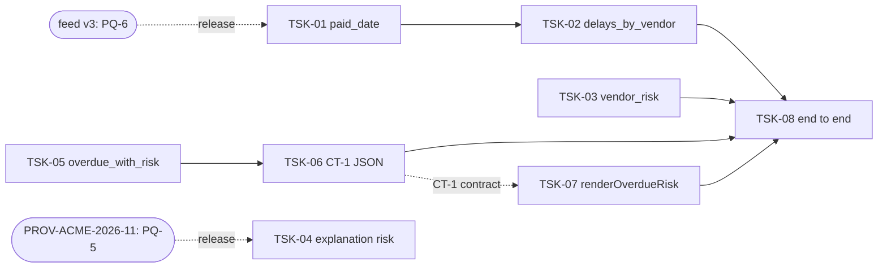

<!-- input feat.tasks for FE-03: from hobasa-design-agent/outputs/FEAT-ZD-48600/feat.tasks.md at commit b0fd4d2, produced by DES-04 -->
# feat.tasks: FEAT-ZD-48600

Engineering tasks for FEAT-ZD-48600 (ZD-48600, "Show which overdue invoices belong to vendors that usually pay late"). This is DES-04 Task Creation (attempt 1), a draft for the Developer gate.

Each user story in feat.stories gets one engineering task. Each task has a goal, the components it touches, the acceptance criteria it must meet, the tests to add, its dependencies and a size budget. Tasks follow the approved design (feat.design Part B and Part C, DT-1 to DT-7) and the developer answers in feat.clarifications. They add no scope beyond feat.stories STORY-01 to STORY-08 and choose no new technology: only the Python 3.9 standard library and Node.js 22 CommonJS (feat.design DD-1). Statements marked **agent judgement** are this agent's proposal; no input states them as fact.

Task IDs (TSK-nn) are labels assigned in this step. They are not taken from any input.

| Field | Value | Source |
|---|---|---|
| Trace ID | FEAT-ZD-48600 | record:brief |
| Step | DES-04 Task Creation (attempt 1) | record:brief |
| Trigger | Design document with HLD & LLD | record:brief |
| Owner / gate | Architect / Developer | record:brief |
| Inputs | feat.stories (0590ea4), feat.design (722a98f), feat.clarifications (36d4dac), org.risk_map (a6b3e2a) | record:brief |
| Companion output | feat.tier (T2) | record:brief; org.risk_map |
| Code read | The four repositories' source and tests from the step's tool view | tool:repo |
| Coding plan | DE + DS + BE + FE in parallel, then the Testing Agent end-to-end proof | feat.design (Part C, last line); feat.clarifications (CL-X1, CL-T5) |

## 1. Task list

| Task | Story | Lane / repository | Goal | Components | Size | Depends on | Ready |
|---|---|---|---|---|---|---|---|
| TSK-01 | STORY-01 | Data Engineering / ap_pipeline | Accept the optional `paid_date` and reject invalid values with reason `'paid_date'` | HC-1 `transform.to_model`, `_parse_paid_date`, `PAID_DATE_REASON` | M | — (feed v3 gates release only) | Yes |
| TSK-02 | STORY-02 | Data Engineering / ap_pipeline | Build each vendor's payment-delay history | HC-2 `delays.delays_by_vendor` (new module) | S | TSK-01 | Yes, after TSK-01 |
| TSK-03 | STORY-03 | Data Science / ap_forecast | Rule-based vendor risk level, no LLM | HC-4 `risk.vendor_risk` (new module), `__all__` | S | — | Yes |
| TSK-04 | STORY-04 | Data Science / ap_forecast | State the risk level in the explanation prompt when given | HC-5 `explain.build_explanation_request(..., risk=None)` | S | — (PROV-ACME-2026-11 order gates release only) | Yes |
| TSK-05 | STORY-05 | Backend / ap_aging | List unpaid invoices more than 30 days past due with vendor risk | HC-6 `aging.overdue_with_risk`, `OVERDUE_AFTER_DAYS`, `TWO_PLACES`, `__all__` | M | — | Yes |
| TSK-06 | STORY-06 | Backend / ap_aging | Serialise the overdue rows to the CT-1 JSON contract | HC-7 `aging.overdue_rows_to_json`, `__all__` | S | TSK-05 | Yes, after TSK-05 |
| TSK-07 | STORY-07 | Frontend / ap_portal | Render the overdue risk table SC-1 | HC-8 `renderOverdueRisk`, `escapeHtml`, `toTwoDecimalString`, `riskClass`, `RISK_CLASSES`, `OVERDUE_HEADINGS` | M | CT-1 field list only (not TSK-06 code) | Yes |
| TSK-08 | STORY-08 | Testing Agent / cross-repository | Prove feed → delays → risk → overdue list → portal table | HC-10 end-to-end harness (test asset, not deployed) | M | TSK-01, 02, 03, 05, 06, 07 merged | After the four lanes merge |

Sources: feat.stories (sections 1, 2, 4); feat.design (A2, Part C, B5); feat.clarifications (section 10). Sizes S and M for TSK-01 to TSK-07 are carried from feat.design Part C ("agent judgement from the number of functions and tests per lane"). The size M for TSK-08 is this step's agent judgement: the harness spans two runtimes and four packages.

## 2. Size budget

The size classes are relative, as in feat.design Part C. This step turns each class into a scope budget: the files a task may change and what it must leave alone. A task that needs a file outside its budget, or a change to an existing signature, stops and goes back to the Architect (agent judgement; the signature rule is org.architecture via feat.design: "Keep every existing signature; add new functions.").

| Class | Budget (agent judgement) |
|---|---|
| S | One new function, or one additive parameter, in one source module, plus its unit tests, any `__init__` export and, where section 2 assigns it, the package version step |
| M | A behaviour change to an existing function or a new function with private helpers and error branches, in one source module, plus its unit tests, exports and the package version step |

No numeric estimate (hours or points) is set. Backlog estimates are the PM's (feat.stories SQ-1), and no input gives a numeric budget. This is open question TKQ-1.

**CI bar for every coding task (TSK-01 to TSK-07).** Compile, unit tests, coverage of at least 90% and static checks stay green. Python: 3.9 syntax only (no `match`, no `X | Y` unions), no `print`, `eval`, `exec` or bare `except`, lines at most 140 characters. ap_portal: no line matching `console.log` or `eval(` (comments included), lines at most 140 characters. Every error branch needs its own test, because a new module with no tests lowers the package's coverage figure (feat.design NF-9; feat.clarifications CL-X3, CL-X5, CL-X6).

**Branch and commit.** Branch `feature/<story>` (the repositories also have `main`, released, and `dev`, integration); commit messages start with the story ID (for example `STORY-01`), and the task ID may follow it (feat.clarifications CL-X7; record:memory conventions). This answers feat.clarifications CQ-5 for this step: the story label stays the commit prefix, and the task ID is added for traceability (agent judgement).

**Version step (one per package).** Each changed package takes one minor version step, for the lane to confirm (feat.design DD-11; feat.clarifications CL-X8). To avoid two tasks bumping the same package, this step assigns each bump to one task (agent judgement). Current versions, which the owning task steps up: ap_pipeline `0.4.0` today → TSK-01; ap_forecast `0.9.0` today → TSK-03; ap_aging `1.4.0` today → TSK-05; ap_portal `2.3.0` today (in `src/ap_portal/index.js` and `package.json`) → TSK-07. The next version number is for the lane to confirm.

**Test files (to limit merge conflicts between parallel tasks).** Agent judgement within feat.design B1.5 to B4.5 and feat.clarifications CL-X4, which allow either the existing test file or a new `tests/test*.py` file: TSK-01 → `tests/test_pipeline.py`; TSK-02 → new `tests/test_delays.py`; TSK-03 → new `tests/test_risk.py`; TSK-04 → `tests/test_forecast.py`; TSK-05 and TSK-06 → new `tests/test_overdue.py`; TSK-07 → `tests/portal.test.js`.

## 3. Tasks

### TSK-01 Accept the optional paid_date in the vendor feed (STORY-01)

| Field | Value | Source |
|---|---|---|
| Story / lane | STORY-01 / Data Engineering, ap_pipeline | feat.stories (STORY-01) |
| Goal | `to_model` reads an optional `paid_date`, adds a `paid_date` key (a `date` or `None`) to every record, and rejects a non-blank invalid value with reason `'paid_date'`; feed v2 still loads | feat.stories (STORY-01); feat.design (HC-1, B1.2) |
| Files in budget | `src/ap_pipeline/transform.py`; `src/ap_pipeline/__init__.py` (version step only); `tests/test_pipeline.py` | feat.design (B1.1, B1.5) |
| Must not change | `ingest.py`, `dq.py`, `pipeline.py`, `schedule.json`; the `to_model` signature and `(records, rejected)` return shape; any existing key or value; `due_date` parsing (no added `strip()`) | feat.design (B1.1, HC-3); feat.stories (AC-01.8); feat.clarifications (CL-DE3) |
| Size | M | feat.design (Part C, DT-1) |
| Depends on | None in code. Feed v3 in production (PQ-6) gates release, not coding; build on synthetic v3 rows | feat.clarifications (CL-DE11); feat.design (Part C "External dependencies") |

**Implementation notes**

1. Keep the existing `try` block exactly as it is. Parse `paid_date` only for a row that passed it: `_parse_paid_date(r.get("paid_date"))`. If the parse sat inside the existing `try`, the reason would become `"ValueError"` and AC-01.4 would fail (feat.clarifications CL-DE1; feat.design B1.2 steps 1 to 3, DD-6).
2. Missing column, `None`, blank or whitespace-only → `None`; otherwise `date.fromisoformat(value.strip())` (feat.clarifications CL-DE2).
3. Unpaid row with a valid `paid_date`: accept it and keep the date (interim DD-7, OQ-B6).

**Acceptance criteria:** AC-01.1 to AC-01.8 (feat.stories STORY-01). Pending markers kept: AC-01.6 (TQ-10), AC-01.7 (OQ-B6) (feat.clarifications section 10).

**Tests to add:** `test_paid_date_empty_is_none`, `test_feed_v2_without_paid_date_column`, `test_paid_date_parsed_for_paid_row`, `test_invalid_paid_date_rejected` (values `"2026-13-01"` and `"not-a-date"`; no compact date forms, CL-DE4), `test_existing_reason_wins`, `test_unpaid_row_keeps_paid_date`. Existing tests pass unchanged (feat.design B1.5; feat.clarifications CL-DE4, CL-DE10).

**Done when:** every listed test passes, the CI bar holds, and the ap_pipeline version step is proposed (feat.stories TK-01.4, TK-01.5).

### TSK-02 Build each vendor's payment-delay history (STORY-02)

| Field | Value | Source |
|---|---|---|
| Story / lane | STORY-02 / Data Engineering, ap_pipeline | feat.stories (STORY-02) |
| Goal | New pure function `delays_by_vendor(records: Iterable[Dict]) -> Dict[str, List[int]]`: `(paid_date - due_date).days` for paid records with a `paid_date`, in feed order, vendors in first-seen order, negative values kept | feat.design (HC-2, B1.2); feat.clarifications (X-1, X-2) |
| Files in budget | New `src/ap_pipeline/delays.py`; new `tests/test_delays.py` | feat.design (B1.1, B1.5) |
| Must not change | `transform.py` (beyond TSK-01); `ap_pipeline/__init__.py` exports (no `__all__` added; import as `from ap_pipeline.delays import delays_by_vendor`) | feat.clarifications (CL-DE9); feat.design (DQ-4) |
| Size | S | feat.design (Part C, DT-2) |
| Depends on | TSK-01 (reads the `paid_date` key) | feat.stories (section 2); feat.design (Part C "Lane dependencies") |

**Implementation notes:** skip unless `record.get("paid")` is truthy and `record.get("paid_date") is not None`; then `result.setdefault(record["vendor"], []).append(...)`. No I/O; do not change `records` (feat.design B1.2; feat.clarifications X-2).

**Acceptance criteria:** AC-02.1 to AC-02.8 (feat.stories STORY-02). Pending marker kept: AC-02.6 (OQ-B6).

**Tests to add:** `test_delays_by_vendor_*`: paid-with-date only; feed order; negative kept; paid-without-date excluded; unpaid-with-date excluded; vendor with no qualifying record has no key; input list unchanged (feat.design B1.5).

**Done when:** tests pass and the CI bar holds, including coverage of the new module (feat.stories TK-02.3; feat.clarifications CL-X6).

### TSK-03 Give each vendor a rule-based risk level (STORY-03)

| Field | Value | Source |
|---|---|---|
| Story / lane | STORY-03 / Data Science, ap_forecast | feat.stories (STORY-03) |
| Goal | New `vendor_risk(history: Iterable[int]) -> str`: `'high'` if `predict_delay_days(history) > 30`, `'medium'` if `> 10`, else `'low'`; no LLM, no network, no `models.json` read | feat.design (HC-4, B2.2, DD-9) |
| Files in budget | New `src/ap_forecast/risk.py` (constants `HIGH_ABOVE_DAYS = 30`, `MEDIUM_ABOVE_DAYS = 10`); `src/ap_forecast/__init__.py` (import, `__all__`, version step); new `tests/test_risk.py` | feat.design (B2.1, B2.2, B2.5) |
| Must not change | `predict.py`, `models.json`; `risk.py` imports only `predict_delay_days`, not `explain` | feat.design (B2.1, B2.2); feat.clarifications (CL-DS4) |
| Size | S | feat.design (Part C, DT-3) |
| Depends on | None (uses the existing `predict_delay_days`) | feat.stories (STORY-03) |

**Implementation notes:** call `predict_delay_days(history)` exactly once, so a generator works (feat.clarifications CL-DS2). Do not validate history values; `predict_delay_days` already applies `int(d)` (CL-DS3).

**Acceptance criteria:** AC-03.1 to AC-03.8 (feat.stories STORY-03). Pending markers kept: AC-03.5 (PQ-1), AC-03.6 (TQ-5).

**Tests to add:** `test_vendor_risk_levels`, `test_vendor_risk_boundaries` (single-value histories `[30]`, `[31]`, `[10]`, `[11]`, so the rounded prediction equals the value; record:memory L-007), `test_vendor_risk_empty_and_early`, `test_vendor_risk_no_llm` (patch `ap_forecast.explain.load_config` to fail), `test_vendor_risk_exported` (feat.design B2.5; feat.clarifications CL-DS1, CL-DS4).

**Done when:** tests pass, the CI bar holds, and the ap_forecast version step is proposed (shared with TSK-04, owned here) (feat.stories TK-03.4).

### TSK-04 State the risk level in the payment-delay explanation (STORY-04)

| Field | Value | Source |
|---|---|---|
| Story / lane | STORY-04 / Data Science, ap_forecast | feat.stories (STORY-04) |
| Goal | `build_explanation_request(vendor, predicted_days, config=None, risk=None)`: unchanged when `risk is None`; otherwise today's prompt followed by `f" Risk level: {risk}."` | feat.design (HC-5, B2.2) |
| Files in budget | `src/ap_forecast/explain.py`; `tests/test_forecast.py` | feat.design (B2.1, B2.5) |
| Must not change | Provider, model and `max_tokens` source (`config or load_config()`); `models.json`; positional use of `config` | feat.stories (AC-04.3, AC-04.4); feat.design (B2.2) |
| Size | S | feat.design (Part C, DT-4) |
| Depends on | None in code. Order against PROV-ACME-2026-11 (PQ-5) gates release: whoever merges second rebases and re-runs T-7. Sending the label to `acme-llm` awaits Architect confirmation (TQ-8), which gates release, not coding | feat.clarifications (CL-DS7, CL-DS8); feat.design (SE-3) |

**Implementation notes:** any non-`None` value is appended without validation (interim IF-4.5; an empty string gives `" Risk level: ."`, CQ-4). Nothing new calls this function with `risk`; it is not in the end-to-end wiring (feat.clarifications CL-DS5, CL-DS6).

**Acceptance criteria:** AC-04.1 to AC-04.5 (feat.stories STORY-04). Pending marker kept: AC-04.5 (TQ-4).

**Tests to add:** `test_request_with_risk` (prompt ends with `' Risk level: high.'`), `test_request_without_risk_unchanged` (with and without explicit `risk=None`). Existing tests `test_predict`, `test_request_uses_config`, `test_request_with_explicit_config` pass unchanged (feat.design B2.5).

**Done when:** tests pass and the CI bar holds (feat.stories TK-04.3).

### TSK-05 List unpaid invoices more than 30 days past due with vendor risk (STORY-05)

| Field | Value | Source |
|---|---|---|
| Story / lane | STORY-05 / Backend, ap_aging | feat.stories (STORY-05) |
| Goal | New pure `overdue_with_risk(invoices, as_of, risk_by_vendor) -> List[Dict]`: unpaid invoices with `days_past_due > 30`, rows with exactly `id`, `vendor`, `days`, `amount` (`Decimal`, 2 dp), `risk` (`'unknown'` when the vendor is not in the map), sorted by `days` descending then `id` ascending | feat.design (HC-6, B3.2) |
| Files in budget | `src/ap_aging/aging.py` (add `OVERDUE_AFTER_DAYS = 30`, `TWO_PLACES = Decimal("0.01")`, `List` typing, the function); `src/ap_aging/__init__.py` (export, version step); new `tests/test_overdue.py` | feat.design (B3.1, B3.2, B3.5) |
| Must not change | `aging_buckets`, `days_past_due`, `bucket_for`, `BUCKETS`. Never call `bucket_for` (`bucket_for(30)` returns `"31-60"`) | feat.design (DD-4, B3.1); feat.clarifications (CL-BE1); tool:repo (`aging.py`) |
| Size | M | feat.design (Part C, DT-5) |
| Depends on | None in code | feat.stories (section 2) |

**Implementation notes:** skip `inv.get("paid")` truthy (D-2026-050); `as_of` is required, with no default (CL-BE2); `Decimal(inv["amount"]).quantize(TWO_PLACES)` with the default context, never `float` (DD-10; record:memory D-2026-044, L-011); missing `vendor` on an overdue unpaid invoice raises `KeyError` (CL-BE4).

**Acceptance criteria:** AC-05.1 to AC-05.10 (feat.stories STORY-05). Pending markers kept: AC-05.6 (PQ-2), AC-05.10 (TQ-9).

**Tests to add** (`AS_OF = date(2026, 10, 25)`, due dates built as `AS_OF - timedelta(days=N)` so `days` is 30, 31, 42 and 75): `test_overdue_boundary_30_and_31` (record:memory L-007), `test_overdue_excludes_paid_and_not_due`, `test_overdue_row_keys_and_sort` (tie on 42: `SYN-INV-002` before `SYN-INV-003`), `test_overdue_unknown_risk`, `test_overdue_amount_quantised` (`Decimal("980.5")` → `Decimal("980.50")`), `test_overdue_missing_vendor_raises`, `test_existing_aging_unchanged` (pins `bucket_for(30) == "31-60"`) (feat.design B3.5; feat.clarifications CL-BE2).

**Done when:** tests pass, the CI bar holds, and the ap_aging version step is proposed (shared with TSK-06, owned here) (feat.stories TK-05.4).

### TSK-06 Hand the overdue list to the portal as JSON, contract CT-1 (STORY-06)

| Field | Value | Source |
|---|---|---|
| Story / lane | STORY-06 / Backend, ap_aging | feat.stories (STORY-06) |
| Goal | New `overdue_rows_to_json(rows) -> str`: JSON array of `{id, vendor, days (int), amount (two-decimal string), risk}` in CT-1 key order and the given row order; `'[]'` when empty; no float anywhere | feat.design (HC-7, CT-1, B3.2) |
| Files in budget | `src/ap_aging/aging.py` (add `import json`, the function); `src/ap_aging/__init__.py` (export); `tests/test_overdue.py` | feat.design (B3.1, B3.2) |
| Must not change | `overdue_with_risk` behaviour from TSK-05; existing ap_aging functions. No transport layer (a transport would re-trigger DES-01) | feat.design (DD-3, A8); feat.clarifications (CL-BE10) |
| Size | S | feat.design (Part C, DT-6) |
| Depends on | TSK-05 (takes its rows) | feat.stories (section 2) |

**Implementation notes:** `str(Decimal(r["amount"]).quantize(TWO_PLACES))` (feat.clarifications X-4). Share the CT-1 field list with the Frontend lane and the Testing Agent (feat.stories TK-06.3).

**Acceptance criteria:** AC-06.1 to AC-06.4 (feat.stories STORY-06). All four stay [Pending TQ-3] (feat.clarifications section 10).

**Tests to add:** `test_rows_to_json`: `"1250.00"` for SYN-INV-004; every `amount` a two-decimal string; `days` an integer; `[]` for no rows; key order. Compare `json.loads` values, not raw strings (feat.design B3.5; feat.clarifications CL-BE8).

**Done when:** tests pass and the CI bar holds (feat.stories TK-06.4).

### TSK-07 Render the overdue risk table (STORY-07)

| Field | Value | Source |
|---|---|---|
| Story / lane | STORY-07 / Frontend, ap_portal | feat.stories (STORY-07) |
| Goal | Exported `renderOverdueRisk(rows)`: `<table class="overdue-risk">`, a plain header row (Invoice, Vendor, Days overdue, Amount), one `<tr class="risk-…">` per row in the given order, amount cell `class="amount"`; `''` for missing, `null` or `[]` | feat.design (HC-8, B4.2); feat.clarifications (CL-FE1, CL-FE2) |
| Files in budget | `src/ap_portal/index.js` (constants, private helpers, export, `VERSION` step); `package.json` (version only); `tests/portal.test.js` | feat.design (B4.1); feat.clarifications (X-5) |
| Must not change | `LABELS`, `formatAmount`, `renderAgingSummary` and their tests; never use `formatAmount`, `Number()` or `parseFloat` for the amount; no re-sorting | feat.design (B4.1, DD-5); feat.clarifications (CL-FE2, CL-FE3, CL-FE7) |
| Size | M | feat.design (Part C, DT-7) |
| Depends on | CT-1 field list only; can be built in parallel with TSK-06 | feat.stories (section 2); feat.design (Part C) |

**Implementation notes:** amount: string only, pattern `^-?\d+(\.\d{1,2})?$`, padded as a string (`"980.5"` → `980.50`); otherwise `TypeError`. `days`: `Number.isInteger`, else `TypeError`. Non-array `rows` (other than missing / `null`) → `TypeError`. `escapeHtml` on `id` and `vendor`; class from the `RISK_CLASSES` allow-list. No risk text, no Risk column, no row actions (feat.design B4.2, B4.4, DD-8; feat.clarifications CL-FE3 to CL-FE5, CL-FE8).

**Acceptance criteria:** AC-07.1 to AC-07.10 (feat.stories STORY-07). Pending markers kept: AC-07.2 (TQ-7), AC-07.6 (TQ-11, OQ-B10), AC-07.7 (OQ-B8), AC-07.8 (TQ-6), AC-07.9 (OQ-B9, PQ-P7).

**Tests to add:** from feat.design B4.5: `renders overdue risk table`, `maps every risk value to its class`, `returns empty string for no rows`, `shows amount strings unchanged`, `pads short amounts as strings`, `rejects non-string amounts`, `escapes id and vendor`, `unexpected risk renders risk-unknown`. From feat.clarifications CL-FE6, for coverage: non-array `rows` → `TypeError`; non-integer `days` → `TypeError`; `null` → `''`; amount with an exponent, a thousands separator or three decimals → `TypeError`. Existing tests pass unchanged. Run with `node:test` and `NODE_PATH=src` (CL-FE10).

**Done when:** tests pass, the CI bar holds, and `VERSION` in `index.js` and `"version"` in `package.json` move together (feat.clarifications X-5; feat.stories TK-07.5).

### TSK-08 Prove feed → delays → risk → overdue list → portal table (STORY-08)

| Field | Value | Source |
|---|---|---|
| Story / lane | STORY-08 / Testing Agent, cross-repository | feat.stories (STORY-08) |
| Goal | End-to-end harness: `pipeline.run` → `delays_by_vendor` → `vendor_risk` per vendor → `overdue_with_risk` → `overdue_rows_to_json` → Node.js 22 `renderOverdueRisk(JSON.parse(payload))`; the rendered rows match `overdue_with_risk` from the same feed | feat.design (B5); feat.clarifications (CL-T1) |
| Files in budget | Test assets only; the harness is not a deployed component (making it one would re-trigger DES-01). Location is the Testing Agent's choice (TKQ-3) | feat.design (HC-10, A8) |
| Must not change | Any product source in the four repositories | feat.design (B5) |
| Size | M (agent judgement) | section 1 |
| Depends on | TSK-01, TSK-02, TSK-03, TSK-05, TSK-06, TSK-07 merged; TSK-04 is not in the flow | feat.stories (section 2, SA-5); feat.clarifications (CL-T5) |

**Implementation notes:** synthetic feed only (`SYN-INV-*`, "Synthetic Vendor &lt;letter&gt;") with an exactly-30-days invoice, a paid invoice, an invalid `paid_date` row and a vendor with no paid history; a fixed `as_of`, not today (feat.clarifications CL-T2, CL-T3, CL-X9).

**Acceptance criteria:** AC-08.1 to AC-08.4 (feat.stories STORY-08). Pending marker kept: AC-08.1 (PQ-2).

**Done when:** AC-08.1 to AC-08.4 are asserted and pass (feat.stories TK-08.3).

## 4. Traceability

| Task | Story | Design task | HLD component | Acceptance criteria | TRD tests |
|---|---|---|---|---|---|
| TSK-01 | STORY-01 | DT-1 | HC-1 | AC-01.1 to AC-01.8 | T-1, T-2, T-3 |
| TSK-02 | STORY-02 | DT-2 | HC-2 | AC-02.1 to AC-02.8 | T-4 |
| TSK-03 | STORY-03 | DT-3 | HC-4 | AC-03.1 to AC-03.8 | T-5, T-6 |
| TSK-04 | STORY-04 | DT-4 | HC-5 | AC-04.1 to AC-04.5 | T-7 |
| TSK-05 | STORY-05 | DT-5 | HC-6 | AC-05.1 to AC-05.10 | T-8, T-9, T-10 (row part), T-11 |
| TSK-06 | STORY-06 | DT-6 | HC-7 | AC-06.1 to AC-06.4 | T-10 (JSON part) |
| TSK-07 | STORY-07 | DT-7 | HC-8 | AC-07.1 to AC-07.10 | T-12 to T-16 |
| TSK-08 | STORY-08 | — (B5) | HC-10 | AC-08.1 to AC-08.4 | T-17 |

Sources: feat.stories (sections 4, 7); feat.design (A2, Part C, D1). Every story STORY-01 to STORY-08 has exactly one task.

## 5. Story commitment status

All eight stories are ready to build on the approved design (feat.clarifications section 10). Commitment to an iteration, priority and estimate are not set here: backlog prioritisation is the PM's (feat.stories SQ-1). This file proposes the stories for commitment with their tasks; the Developer gate confirms the task breakdown and sizes.

## 6. Assumptions (new in this step; agent judgement, please confirm at the gate)

| ID | Assumption |
|---|---|
| TA-1 | One engineering task per story, matching feat.design DT-1 to DT-7, plus TSK-08 for the end-to-end story |
| TA-2 | The size budget is a scope budget (files in budget, must not change), not a time estimate |
| TA-3 | Each package's version step is owned by one task (TSK-01, TSK-03, TSK-05, TSK-07) |
| TA-4 | Test file split as in section 2, to reduce merge conflicts between parallel tasks |
| TA-5 | Commit messages keep the story ID as the prefix; the task ID may follow (answers CQ-5 for this step) |

## 7. Open questions (all non-blocking)

| ID | Question | Interim answer | Owner (proposed) |
|---|---|---|---|
| TKQ-1 | Should tasks carry a numeric estimate (hours or points)? No input gives one | Size class and scope budget only | Developer / PM |
| TKQ-2 | Confirm the version-step owners and test-file split (TA-3, TA-4) | As in section 2 | Developer |
| TKQ-3 | Where should the end-to-end harness live? No input names a location | Testing Agent's choice; test asset, not deployed | Testing Agent |

Carried, unchanged and non-blocking: TQ-1 to TQ-11 (feat.trd via feat.stories and feat.design), DQ-1 to DQ-5 (feat.design D3), CQ-1 to CQ-4 and CQ-6 (feat.clarifications 9.1), SQ-1 to SQ-4 (feat.stories 6.1), OQ-B1 to OQ-B10, PQ-1 to PQ-6, PQ-P1 to PQ-P7 (feat.stories 6.2). CQ-5 is answered for this step by TA-5.

## 8. Validation check

| Check | Result | Source |
|---|---|---|
| Every story has a task with goal, components, acceptance criteria, tests, dependencies and size | Pass (sections 1, 3) | record:brief |
| No product code changed; no new technology | Pass (DD-1 carried) | feat.design (DD-1) |
| Every task cites the design, a contract or a story | Pass | feat.design; feat.stories |
| Decisions D-2026-031, D-2026-044, D-2026-050; lessons L-007, L-011 | Consistent (TSK-03, TSK-05, TSK-06, TSK-07) | record:memory |
| Conflict with an approved output | None. Form differences resolved as in feat.clarifications section 1 | feat.clarifications (X-1 to X-6) |
| Blocking questions | None | — |
