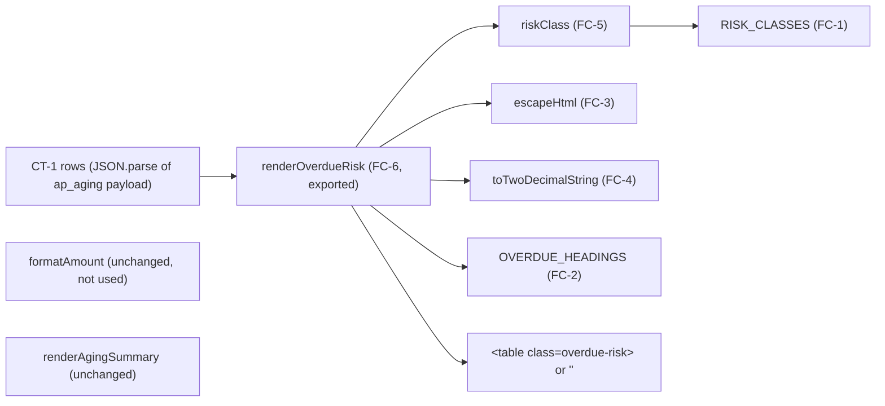

# task.components: FEAT-ZD-48600

Components and layers the Frontend lane creates or updates for FEAT-ZD-48600 (ZD-48600, "Show which overdue invoices belong to vendors that usually pay late"). This is FE-03 Identify the components/layers to be changed (attempt 5).

The Frontend scope is one task, TSK-07 (STORY-07): render the overdue risk table SC-1 with `renderOverdueRisk`. This file reads the current ap_portal code, lists what must be created or updated, and keeps the change to the smallest set of files and lines the approved design allows. Statements marked **agent judgement** are this agent's proposal; no input states them as fact. No code is changed in this step.

Each repository fact below cites the step's tool view (tool:repo), a contracted input that states it (feat.tasks, feat.stories, feat.prd, feat.trd, feat.design, task.repo_access) or record:memory.

| Field | Value | Source |
|---|---|---|
| Trace ID | FEAT-ZD-48600 | record:brief |
| Step | FE-03 Identify the components/layers to be changed (attempt 5) | record:brief |
| Task / story | TSK-07 / STORY-07, Frontend lane, repository ap_portal | feat.tasks (section 1, TSK-07); feat.stories (STORY-07) |
| Design component | HC-8 `renderOverdueRisk` (new); HC-9 `formatAmount`, `renderAgingSummary` (unchanged) | feat.design (A2, B4) |
| Repository and branch | ap_portal, branch `feature/story`, write access confirmed | task.repo_access (section 1) |
| Runtime / tests / CI | Node.js 22 CommonJS; `node:test` with `NODE_PATH=src`; CI command `node ci.mjs` | task.repo_access (section 2); feat.tasks (TSK-07 "Tests to add") |
| Code read | `src/ap_portal/index.js`, `tests/portal.test.js` | tool:repo |

## 1. What the existing code does

| Item | Current state | What it means for this change | Source |
|---|---|---|---|
| Layer | `index.js` holds view helpers that return HTML strings ("AP portal view helpers: render the aging summary returned by the ap_aging service as HTML") | ap_portal has one product layer, view helpers. The new table is one more helper in that layer | tool:repo |
| `index.js` exports | `{ VERSION, LABELS, formatAmount, renderAgingSummary }`; `VERSION = '2.3.0'` | `renderOverdueRisk` is added to this export object; the existing four exports stay | tool:repo; feat.design (B4.2) |
| `renderAgingSummary(buckets)` | Maps `LABELS` keys to `<tr><td>…</td><td class="amount">…</td></tr>` with template strings, joins with `''`, wraps in `<table class="aging-summary">` | The new function follows the same plain template-string pattern and `class="amount"` cell, but must not copy the absence of escaping, because it renders feed data | tool:repo; feat.trd (F-13, IF-7.2, IF-7.3) |
| `formatAmount(value)` | `Number(value \|\| 0).toFixed(2)`: formats through a binary float | Must not be reused for the overdue amount (D-2026-044); a new string-only helper is needed. `formatAmount` itself stays unchanged (TQ-2) | tool:repo; feat.trd (F-12, R-2); record:memory (D-2026-044, L-011) |
| Escaping | No HTML-escape helper exists | A new private helper is needed for `id` and `vendor` | tool:repo; feat.trd (F-13, IF-7.7) |
| Tests | Two `node:test` tests loading the package with `require('ap_portal')`, run with `NODE_PATH=src` | New tests go in the same file with the same `require`; existing tests stay unchanged | tool:repo; feat.tasks (section 2 "Test files", TSK-07) |
| Version | `2.3.0` in `src/ap_portal/index.js` and `package.json` | Both move together by one minor step, owned by TSK-07 | feat.tasks (section 2 "Version step"); feat.trd (F-13) |
| CI bar | Compile, unit tests, coverage of at least 90% and static checks; for ap_portal no line matching `console.log` or `eval(`, lines at most 140 characters | Every new helper branch must be exercised by a test; no `console.log`, no `eval(`, short lines | feat.tasks (section 2 "CI bar"); task.repo_access (section 2) |
| Signature rule | "Keep every existing signature; add new functions." | `renderOverdueRisk` is a new function; no existing signature changes | feat.design (header, B4.1) |

## 2. Components and layers to create or update

ap_portal has one product layer (view helpers in `src/ap_portal/index.js`) plus its unit tests and package metadata. All new code goes into the existing `index.js`; no new source file is created (feat.design DD-2, B4.1; feat.tasks TSK-07 "Files in budget").

| # | Layer | File | Component | Change | Exported | Why it is needed | Source |
|---|---|---|---|---|---|---|---|
| FC-1 | View helper (constants) | `src/ap_portal/index.js` | `RISK_CLASSES = ['high', 'medium', 'low', 'unknown']` | Create | No | Allow-list for the row class, so feed data cannot inject a class name | feat.design (B4.2, B4.3); feat.trd (IF-7.4) |
| FC-2 | View helper (constants) | `src/ap_portal/index.js` | `OVERDUE_HEADINGS = ['Invoice', 'Vendor', 'Days overdue', 'Amount']` | Create | No | The four headings in order; "Days overdue", never "Late" | feat.design (B4.2, NF-12); feat.trd (IF-7.2); feat.prd (AC-19, NFR-10) |
| FC-3 | View helper (private) | `src/ap_portal/index.js` | `escapeHtml(value)` | Create | No | Escapes `&`, `<`, `>`, `"`, `'` in `id` and `vendor` | feat.design (B4.2, SE-2); feat.trd (IF-7.7) |
| FC-4 | View helper (private) | `src/ap_portal/index.js` | `toTwoDecimalString(value)` | Create | No | String-only amount display: accepts only a string matching `^-?\d+(\.\d{1,2})?$`, pads the fraction to two digits as text, else throws `TypeError`; never `Number()`, `parseFloat` or `formatAmount` | feat.design (B4.2, B4.4, DD-5, DD-8); feat.tasks (TSK-07 "Implementation notes") |
| FC-5 | View helper (private) | `src/ap_portal/index.js` | `riskClass(risk)` | Create | No | `'risk-' + risk` for a value in `RISK_CLASSES`, else `'risk-unknown'` | feat.design (B4.2); feat.trd (IF-7.4) |
| FC-6 | View helper (public) | `src/ap_portal/index.js` | `renderOverdueRisk(rows)` | Create | Yes | Renders SC-1 from CT-1 rows: `''` for missing, `null` or `[]`; `TypeError` for any other non-array; `<table class="overdue-risk">`, plain header row, one `<tr class="risk-…">` per row in the given order with cells id, vendor, days, amount (`class="amount"`); `days` must pass `Number.isInteger`, else `TypeError` | feat.design (HC-8, B4.2 steps 1 to 4, B4.4); feat.tasks (TSK-07 "Goal") |
| FC-7 | Module interface | `src/ap_portal/index.js` | `module.exports` | Update (additive) | — | Add `renderOverdueRisk` next to `VERSION`, `LABELS`, `formatAmount`, `renderAgingSummary` | feat.design (B4.2); feat.stories (AC-07.10); tool:repo |
| FC-8 | Package metadata | `src/ap_portal/index.js` | `VERSION` | Update | (already exported) | One minor version step from `2.3.0`, moved together with `package.json`; exact number for the lane to confirm at coding | feat.tasks (section 2 "Version step", TSK-07 "Done when"); feat.design (DD-11) |
| FC-9 | Package metadata | `package.json` | `"version"` | Update (version only) | — | Same value as `VERSION` | feat.tasks (TSK-07 "Files in budget", TSK-07 "Done when") |
| FC-10 | Unit tests | `tests/portal.test.js` | New `node:test` cases | Update (additive) | — | Cover FC-1 to FC-7 and every error branch for the 90% coverage bar; existing two tests unchanged | feat.design (B4.5); feat.tasks (section 2 "CI bar", TSK-07 "Tests to add"); tool:repo |

Sources: feat.design (A3 CT-1, B4.1, B4.2); tool:repo.

## 3. Components that stay unchanged

| Component | File | Rule | Source |
|---|---|---|---|
| `LABELS` | `src/ap_portal/index.js` | No change | feat.tasks (TSK-07 "Must not change"); feat.design (B4.1) |
| `formatAmount` | `src/ap_portal/index.js` | No change and not called by the new code (float conflict kept open as TQ-2) | feat.trd (F-12, C-9, TQ-2); feat.design (HC-9, DD-5) |
| `renderAgingSummary` | `src/ap_portal/index.js` | No change and not reused | feat.trd (C-9); feat.design (HC-9) |
| Existing tests (`formats amounts with two decimals`, `renders every bucket in order`) | `tests/portal.test.js` | No change; must still pass | tool:repo; feat.stories (AC-07.10); feat.trd (T-16) |
| Any file outside the budget | — | No change; the budget is `index.js`, `package.json` (version only) and `tests/portal.test.js` | feat.tasks (TSK-07 "Files in budget"; section 2 "Size budget") |
| Transport, host page, styles, row actions | — | Not in ap_portal and out of this design (no transport layer; no host page, navigation, filters or row actions) | feat.design (A1, DD-3, A8); feat.stories (AC-07.9) |

## 4. Minimum-code approach

The approved design already fixes the component list (FC-1 to FC-7). Within it, this step proposes how to keep the change small (agent judgement unless a source is given):

1. **One file, appended.** Add the two constants and four functions to `index.js` between `renderAgingSummary` and `module.exports`; change only the `VERSION` line and the export line among existing lines. No new module, so the `require('ap_portal')` resolution and the test setup need no change (feat.design B4.1; tool:repo).
2. **Reuse the existing pattern, not the existing helpers.** Build rows with `map(...).join('')` and template strings as `renderAgingSummary` does; do not call `formatAmount` (tool:repo; feat.design DD-5).
3. **Header from the constant.** Build the header row by mapping `OVERDUE_HEADINGS` to `<th>` cells and joining them with `''` inside a plain `<tr>`, so the four headings appear once in the code (feat.trd IF-7.2).
4. **Single validation point per field.** `toTwoDecimalString` owns all amount checks (type and pattern in one regular-expression test); the `days` check is one `Number.isInteger` test inside the row template; `riskClass` is one `includes` lookup. Each throw path is short, which keeps the branches few and easy to cover (feat.design B4.4; feat.tasks TSK-07 "Implementation notes").
5. **Padding as text.** Split the matched string at `.` and pad the fraction with `'0'` as text; no number conversion (feat.design B4.2; feat.stories AC-07.5, AC-07.6).
6. **No new dependency, no build step.** Node.js 22 CommonJS built-ins only (feat.design DD-1).
7. **Static-check safe names.** No identifier or comment contains `console.log` or `eval(`; lines stay at most 140 characters (feat.tasks section 2 "CI bar").

## 5. Tests to add (FC-10)

All in `tests/portal.test.js`, using `require('ap_portal')` and synthetic data (`SYN-INV-*`, "Synthetic Vendor &lt;letter&gt;"). Private helpers are covered through `renderOverdueRisk`.

| Test | Covers | Acceptance criteria / TRD test | Source |
|---|---|---|---|
| `renders overdue risk table` | FC-2, FC-6, FC-7 | AC-07.1, AC-07.2; T-12 | feat.design (B4.5) |
| `maps every risk value to its class` | FC-1, FC-5 | AC-07.3; T-12 | feat.design (B4.5) |
| `returns empty string for no rows` (`[]`, `undefined`, `null`) | FC-6 | AC-07.4; T-13 | feat.design (B4.5); feat.tasks (TSK-07 "Tests to add") |
| `shows amount strings unchanged` (`"1250.00"`, `"15.00"`, a string with more digits than a JS `Number` holds) | FC-4 | AC-07.5; T-14 | feat.design (B4.5) |
| `pads short amounts as strings` (`"980.5"` → `980.50`) | FC-4 | AC-07.6; T-14 | feat.design (B4.5) |
| `rejects non-string amounts`; exponent, thousands separator, three decimals → `TypeError` | FC-4 error branch | DD-8 | feat.design (B4.5); feat.tasks (TSK-07 "Tests to add") |
| `escapes id and vendor` (`<`, `&`, `"`) | FC-3 | AC-07.7; T-15 | feat.design (B4.5) |
| `unexpected risk renders risk-unknown` | FC-5 | AC-07.8; T-15 | feat.design (B4.5) |
| Non-array `rows` → `TypeError`; non-integer `days` → `TypeError` | FC-6 error branches | DD-8 | feat.tasks (TSK-07 "Tests to add") |
| Existing tests unchanged | `LABELS`, `formatAmount`, `renderAgingSummary` | AC-07.10; T-16 | tool:repo; feat.trd (T-16) |

## 6. Traceability

| Acceptance criterion (STORY-07) | Components |
|---|---|
| AC-07.1 table, headings, one row per item in order | FC-2, FC-6 |
| AC-07.2 plain header row [Pending TQ-7] | FC-2, FC-6 |
| AC-07.3 risk classes | FC-1, FC-5 |
| AC-07.4 empty string for no rows | FC-6 |
| AC-07.5 amount strings unchanged, no float | FC-4 |
| AC-07.6 padding [Pending TQ-11, OQ-B10] | FC-4 |
| AC-07.7 HTML escaping [Pending OQ-B8] | FC-3 |
| AC-07.8 unknown risk → `risk-unknown` [Pending TQ-6] | FC-1, FC-5 |
| AC-07.9 no Risk column, no row actions [Pending OQ-B9, PQ-P7] | FC-2, FC-6 (nothing added) |
| AC-07.10 existing exports unchanged, new export added, no `console.log` / `eval` | FC-7, FC-10; section 3 |

Sources: feat.stories (STORY-07); feat.design (B4.5, D1); feat.trd (IF-7, T-12 to T-16).

## 7. Assumptions (agent judgement, for the gate)

| ID | Assumption |
|---|---|
| CA-1 | All new code lives in `index.js`; no new module is created, so the CI setup and package resolution stay as they are |
| CA-2 | Private helpers are not exported and are tested only through `renderOverdueRisk` |
| CA-3 | The `risk-*` classes need no stylesheet change in ap_portal. The tool view shows only view helpers that return HTML strings, and the host page is out of this design |
| CA-4 | The interim answers in feat.design (TQ-6 allow-list, TQ-7 plain header, TQ-11 padding, OQ-B8 escaping, DQ-3 `TypeError`) are built as designed; if an answer differs, only FC-1/FC-5, FC-2, FC-4, FC-3 or the throw paths change |

## 8. Open questions (all non-blocking)

| ID | Question | Interim answer | Owner (proposed) |
|---|---|---|---|
| CQ-FE-1 | Where are the `risk-high`, `risk-medium`, `risk-low` and `risk-unknown` styles defined? ap_portal only emits the class | Outside ap_portal; the class is the only output (CA-3) | UX lead |
| CQ-FE-2 | Confirm the exact next minor version for `VERSION` and `package.json` | Next minor step from `2.3.0`, set during coding (agent judgement) | Developer |
| RAQ-1 (carried) | Is `feature/story` the intended branch for TSK-07? | Work on `feature/story`; commits start with `STORY-07` | Developer |

Carried, unchanged: TQ-2, TQ-6, TQ-7, TQ-11 (feat.trd); OQ-B8, OQ-B9, OQ-B10 (feat.prd); DQ-3 (feat.design); PQ-P7 (feat.prototype, as carried in feat.stories). None blocks this step.

## 9. Validation check

| Check | Result | Source |
|---|---|---|
| Existing code read before listing changes | Pass (section 1) | tool:repo |
| Every component traces to the design and a story criterion | Pass (sections 2, 6) | feat.design (B4); feat.stories (STORY-07) |
| Only files in the TSK-07 budget are changed | Pass: `index.js`, `package.json` (version only), `tests/portal.test.js` | feat.tasks (TSK-07) |
| Existing signatures kept; new function added | Pass | feat.design (header, B4.1) |
| D-2026-044 / L-011 (no float for money) | Consistent: FC-4 is string-only; `formatAmount` not used | record:memory; feat.design (NF-1) |
| Blocking questions | None | — |
